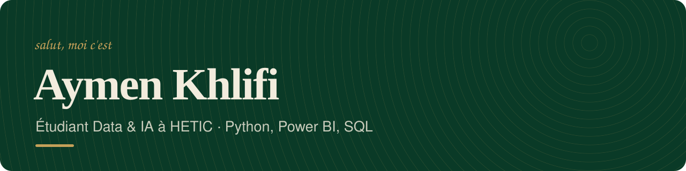

Je suis étudiant en **Bachelor Data & IA à HETIC**, à Montreuil. Ce que je préfère, c'est le moment où un gros tableau de chiffres finit par dire quelque chose.

**Mon portfolio :** [portfolio-ay-kh.netlify.app](https://portfolio-ay-kh.netlify.app)

## Mes projets

| | Projet | En une phrase | Outils |
|:-:|---|---|---|
| 👜 | **[Data Monitor](https://github.com/AkhyRider/data-monitor-luxe)** | Benchmark de 572 sacs de luxe face à Chanel, Goyard, Louis Vuitton et Balenciaga, avec un dashboard et trois conseils au client | Python, Power Query, Power BI |
| 🛒 | **[Analyse e-commerce Olist](https://github.com/AkhyRider/projet-analyse-ecommerce)** | 96 000 commandes d'une marketplace brésilienne, quatre questions métier | Python, Pandas, Seaborn |
| 🎬 | **[Anime Editorial Scoring](https://github.com/AkhyRider/Anime-Editorial-Scoring)** | Un score qui classe 72 animés en comptant aussi la régularité des épisodes | Python, Pandas |
| 📚 | **[Wiki Learn](https://github.com/Louisnrry/wiki-learn)** | Wikipédia transformé en parcours avec XP et badges, fait en 48 h de hackathon | React, GSAP |
| 🎰 | **[Jeu-concours Foot Locker](https://github.com/AkhyRider/FootLocker-Game-HETIC)** | Une machine à sous pour collecter des contacts, consentement RGPD en premier | HTML, CSS, JavaScript |

## Ma façon de travailler

**1. Collecter** → **2. Nettoyer** → **3. Analyser** → **4. Raconter**

Scraper un site ou charger un dataset, le nettoyer (souvent l'étape la plus longue), construire les bons indicateurs, puis finir sur un dashboard et des conseils concrets.

## Mes outils

## Me contacter

Pour un stage, une alternance ou une question sur un projet : **khlifia381@gmail.com**
